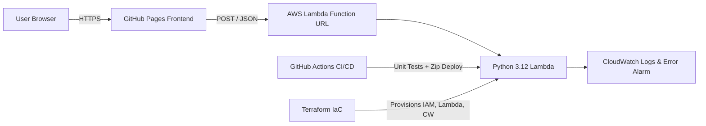

# SpamGuard — Serverless Spam Detector with Terraform & CI/CD

A lightweight, reproducible cloud project featuring a static frontend hosted on **GitHub Pages**, a serverless Python backend on **AWS Lambda (Function URL)**, **Terraform** Infrastructure as Code, **GitHub Actions** CI/CD, and **CloudWatch** monitoring.

## Architecture



## Tech Stack

- **Frontend:** HTML, Tailwind CSS, Vanilla JS (`index.html`) — hosted on GitHub Pages
- **Backend:** Python 3.12 AWS Lambda (`backend/lambda_function.py`)
- **IaC:** Terraform (`infra/main.tf`) — least-privilege IAM role, Lambda Function URL with CORS, CloudWatch Log Group (7-day retention), and Error Alarm
- **CI/CD:** GitHub Actions (`.github/workflows/deploy.yml`) — runs unit tests on every push/PR and auto-deploys Lambda on `main`

## AWS Cost Breakdown (Free Tier)

| Service | Free Tier Limit | Estimated Monthly Cost |
| :--- | :--- | :--- |
| GitHub Pages & Actions | Free for public repositories | ₹0 |
| AWS Lambda | 1M requests + 400,000 GB-s/month (Always Free) | ₹0 |
| Lambda Function URL | Included with Lambda (no API Gateway fee) | ₹0 |
| CloudWatch Logs & Alarm | Basic metrics & 7-day log retention | ₹0 |

## Quick Start

### 1. Run Tests Locally
```bash
python3 -m unittest discover -s backend -v
```

### 2. Deploy Frontend (GitHub Pages)
1. Push this repository to GitHub (public repo).
2. Go to **Settings → Pages → Source: Deploy from a branch (`main` / `/root`)**.
3. Your live site will be available at `https://<your-username>.github.io/<repo-name>/`.

### 3. Provision AWS Infrastructure (Terraform)
```bash
cd infra
terraform init
terraform apply
```
Copy the `lambda_function_url` output, open your live SpamGuard page, click **Local Engine**, and paste the URL to switch to your live AWS Lambda backend.

### 4. Enable Auto-Deploy (GitHub Actions)
Add `AWS_ACCESS_KEY_ID` and `AWS_SECRET_ACCESS_KEY` to **Repo Settings → Secrets and variables → Actions**. Every push to `main` will run tests and update the Lambda function automatically.

### 5. Clean Up
```bash
cd infra
terraform destroy
```
